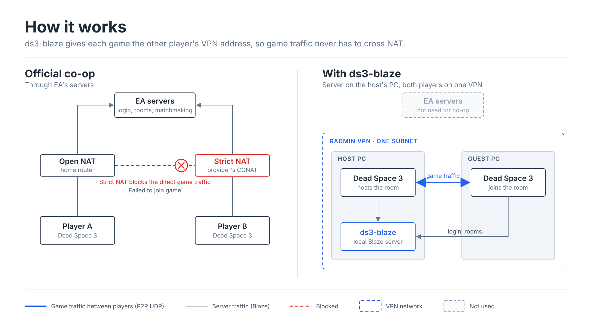

# Dead Space 3 co-op without EA servers

`ds3-blaze` is a local Blaze server for Dead Space 3 co-op on PC. It stands in for the EA servers that bring players together: the redirector, login, game rooms, matchmaking and QoS. Game traffic flows directly between the players over Radmin VPN (or any other VPN that puts them on one subnet), so the ISP's NAT no longer gets in the way.

The game is still launched through the EA App; the server replaces Blaze only.



## Status

| Stage | Status |
|---|---|
| Redirector (SSLv3) | works in game |
| Online login | works in game |
| Host's room | works in game: create, play, quit with a save |
| Second player | works in game through quick match and through an EA App invite |

Protocol analysis, traffic captures and the work plan: [docs/](docs/README.md).

## Getting it

Release archives are on the repository's Releases page. Each holds `ds3-blaze.exe`, `scripts\hosts.ps1`, this README and the license; the commands below run from the unpacked folder.

GitHub Actions builds every release archive and signs a build provenance attestation for it and for the `ds3-blaze.exe` inside. With the [GitHub CLI](https://cli.github.com/) installed, either file can be checked against this repository's release workflow; the command fails for a file that workflow did not produce:

```powershell
gh attestation verify <archive or ds3-blaze.exe> --repo 1minEpowMinX/ds3-blaze --signer-workflow 1minEpowMinX/ds3-blaze/.github/workflows/release.yml
```

To build from source instead, install stable Rust on Windows (`net-check` reads the network settings through PowerShell) and run `tools\package.ps1`. It builds the release binary and writes the same archive to `dist\`.

```powershell
powershell -ExecutionPolicy Bypass -File .\tools\package.ps1
```

Running `ds3-blaze.exe` without arguments prints its commands and their options.

## Running

Both players join the same Radmin VPN network, and both run the network check at the same time, each with the other PC's VPN address:

```powershell
.\ds3-blaze.exe p2p-check --peer <other PC's VPN address>
```

Back up your saves before the first test sessions.

### Host

The server runs on the host's PC.

1. Start the server on all interfaces with your VPN address. `--player` names the guest; without it the guest shows up as `Player-<last octet of the guest's address>`:

   ```powershell
   .\ds3-blaze.exe serve --bind 0.0.0.0 --advertise <host's VPN address> --name <host's name> --player <guest's VPN address>=<guest's name>
   ```

   On a VPN network open to strangers, add `--only-listed`: the server then accepts only your own PC and the `--player` addresses.

2. Point `gosredirector.ea.com` at your own PC from an elevated PowerShell:

   ```powershell
   powershell -ExecutionPolicy Bypass -File .\scripts\hosts.ps1 -Enable
   ```

3. Start the game, go online in co-op and create a game. A **public** game takes the guest through quick match; a private one takes invites only, so invite the guest through the EA App from inside it.

If the guest does not get in, the `logs\` folder shows how far the server got. The logs hold friend lists and addresses, so share them only privately.

### Guest

1. Point `gosredirector.ea.com` at the host from an elevated PowerShell:

   ```powershell
   powershell -ExecutionPolicy Bypass -File .\scripts\hosts.ps1 -Enable -Address <host's VPN address>
   ```

2. Optionally, test the whole path to the host's server without the game:

   ```powershell
   .\ds3-blaze.exe selftest --host <host's VPN address>
   ```

3. Start the game and go online in co-op. Then either:

   - pick quick match to join the host's public game. The server puts you into it as soon as it exists, retrying for as long as the game's search lasts, so you may start searching a little before the host's game is up;
   - or accept the host's invite in the EA App. The server knows players by the addresses they connect from, not by EA account, so it matches the invite to the host only while the two of you are the only players on it.

### Afterwards

Both players run `hosts.ps1 -Disable` to go back to the EA servers.

## Logs and privacy

The server writes its logs to `logs/` under the directory it is started from. Logs of the `proxy` command contain EA account data, the persona name, the friend list and IP addresses. Do not publish them. `.gitignore` keeps logs, traffic captures, memory dumps and game files out of the repository.

## Development

Each feature or fix is developed on its own branch named `<type>/<name>`, where `<type>` is one of the commit types below, and lands on `main` through a merge (`git merge --no-ff`); nothing is committed to `main` directly.

CI on GitHub Actions checks every push to any branch and every pull request into `main`: `tools\check-commits.ps1` over the branch name and the subjects of the commits the branch adds, `tools\check-clean.ps1` over the tracked files, then `cargo fmt`, `cargo clippy` with warnings as errors, a build and `selftest` against a local `serve`. A newer push to the same branch cancels the check still running for it. Pushing an annotated tag `v<version>` that matches `ds3-blaze/Cargo.toml` runs the same checks, packs the archive, attests its build provenance and opens a draft release. Its notes are rendered by [git-cliff](https://git-cliff.org) from `cliff.toml`: the tag's message comes first as the summary, followed by the commits since the previous tag. Commit messages follow [Conventional Commits](https://www.conventionalcommits.org/), with the types listed in `$Types` of `tools\check-commits.ps1`; a `Deploy:` trailer lands under "Action required" in the notes. With git-cliff installed, `git cliff --unreleased` previews the next release's notes.

The same checks run locally once the hooks are enabled in a clone: the repository check before each commit, and the naming check on each commit message, which also refuses a commit on `main` other than one that concludes a merge:

```powershell
git config core.hooksPath .githooks
```

Personal values that must never be committed, such as an EA persona name or a home IP address, go one per line into `.git\info\sensitive.txt`. The check searches staged files for them; the file itself stays inside `.git`.

## Credits

- [Pocket Relay](https://github.com/PocketRelay) (Jacobtread, MIT): Blaze component ids and message field layouts, adapted to Dead Space 3. The headers of `components.rs`, `models.rs` and `game.rs` cite the sources.
- [blaze-ssl-async](https://github.com/jacobtread/blaze-ssl-async) and [tdf](https://crates.io/crates/tdf) (Jacobtread, MIT): SSLv3 and the TDF format, used as dependencies.
- [Aim4kill/BlazeSDK](https://github.com/Aim4kill/BlazeSDK): Blaze 3 command and notification definitions.

Reference copies of the upstream projects go into `vendor/`, which is not tracked:

```powershell
git clone https://github.com/PocketRelay/Server vendor/pocket-relay-server
git clone https://github.com/PocketRelay/Client vendor/pocket-relay-client
git clone https://github.com/PocketRelay/PocketRelayClientShared vendor/pocket-relay-client-shared
git clone https://github.com/jacobtread/blaze-ssl-async vendor/blaze-ssl-async
```

## License

[MIT](LICENSE). Dead Space 3 and Blaze belong to Electronic Arts. This project is not affiliated with EA and contains no game files.
